 

## About

Senior Front-end Engineer with **10+ years** of experience building high-performance web applications, scalable design systems, and developer tooling. I care about the details users feel — speed, accessibility, and polished interactions — backed by architecture that teams can grow with. Beyond the browser, I ship Go services, Laravel and WordPress platforms, Shopify apps and IoT edge software.

Currently building modern web experiences at **[SCALATER](https://github.com/scalater)**, where I also integrate LLMs into products and internal workflows.

## What I do

<table>
  <tr>
    <td width="50%" valign="top">
      <h4>Frontend Architecture</h4>
      Scalable applications with React, Next.js, Vue and Nuxt — clear module boundaries, typed APIs and maintainable state.
    </td>
    <td width="50%" valign="top">
      <h4>Design Systems &amp; UI</h4>
      Enterprise component libraries, responsive layouts and micro-interactions that stay consistent across products.
    </td>
  </tr>
  <tr>
    <td width="50%" valign="top">
      <h4>Web Performance</h4>
      Core Web Vitals, accessibility (a11y), bundle budgets and modern build tooling for fast, inclusive experiences.
    </td>
    <td width="50%" valign="top">
      <h4>AI &amp; Developer Tooling</h4>
      Agent-driven workflows with Claude Code and Antigravity, MCP servers, and LLM integrations with Claude, Gemini and OpenAI.
    </td>
  </tr>
</table>

## Tech stack

| Area | Tools |
| :-- | :-- |
| **Languages** |  |
| **Frontend** |  |
| **Styling &amp; UI** |     |
| **Backend &amp; data** |     |
| **Commerce** |   |
| **Cloud &amp; DevOps** |  |
| **IoT &amp; edge** |   |
| **Testing** |   |
| **AI agents** |      |
| **AI platforms** |     |

## GitHub activity

  

---

  Open to conversations about front-end architecture, design systems and AI-powered products — reach out on <a href="https://linkedin.com/in/edisoft00">LinkedIn</a>.

